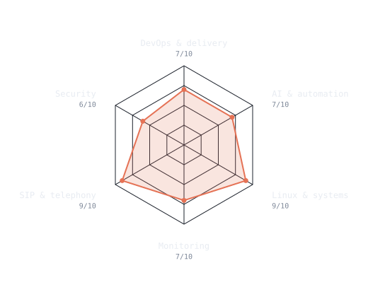
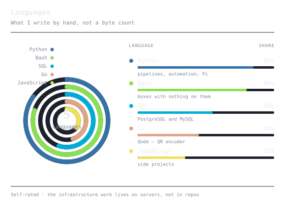
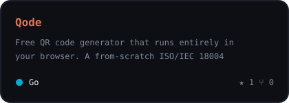
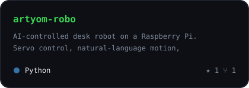
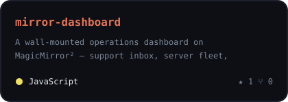
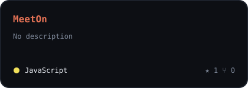
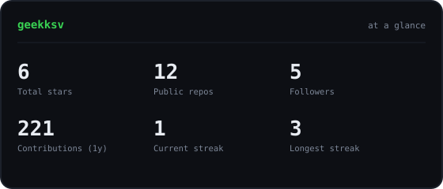

<!--
  github.com/geekksv/geekksv — the repo name matches the username, which is what
  makes GitHub render this file at the top of the profile page.

  Nothing here is fetched from a third-party chart service at render time. The
  portrait, charts and cards are SVGs committed to assets/, drawn by the scripts
  in scripts/ and refreshed by the workflows in .github/workflows/. See SETUP.md.
-->

<div align="center">

<!-- PORTRAIT — generated by scripts/dotify.py from assets/source.webp.
     Transparent source, so one file works on both GitHub themes:
       python scripts/dotify.py assets/source.webp -o assets/portrait \
         --cols 120 --color --flat --detail 0.72 -->


<br>

<a href="https://geekksv.vercel.app/">
  
</a>

<br>

<a href="https://geekksv.vercel.app/"></a>
<a href="https://linkedin.com/in/geekksv"></a>
<a href="mailto:write.ksv@gmail.com"></a>
<a href="https://geekksv.vercel.app/resume.pdf"></a>

</div>

---

## `~/` whoami

```console
$ cat about.txt
```

I run the session border controller layer on **OpenSIPS** and the Linux estate beneath it for a
production telephony platform carrying around a thousand concurrent calls. When it works,
nobody thinks about it. That is the job.

- Day-to-day owner of **10–25 Debian and Ubuntu servers** — networking, Nginx, TLS, hardening
- **Python and Bash** for everything that was never meant to stay manual, on systemd timers and cron
- Open-source **LLMs run locally** on hardware I control, rather than through a hosted API
- Invited back twice to my own polytechnic as a subject expert — **60+ students**, Linux and ethical hacking
- Reading for a **BS in AI & Cybersecurity** at IIT Patna
- Currently working through **Kubernetes, Terraform and Ansible**

> Most of what I do is not open source — it is a telephony platform and a Linux estate that
> belong to someone else. The repos here are the part I can show. The rest is written up at
> **[geekksv.vercel.app](https://geekksv.vercel.app/)**.

<br>

<div align="center">

## `~/` toolbox


</div>

---

<div align="center">

## `~/` where the time goes

<table>
<tr>
<td width="52%" align="center" valign="middle">

<!-- Self-rated. Edit assets/skills.json and the workflow redraws this.
     Deliberately NOT computed from repo byte counts — see the note in that file. -->
<picture>
  <source media="(prefers-color-scheme: dark)"  srcset="assets/radar-dark.svg">
  <source media="(prefers-color-scheme: light)" srcset="assets/radar-light.svg">
  
</picture>

</td>
<td width="48%" align="center" valign="middle">

<picture>
  <source media="(prefers-color-scheme: dark)"  srcset="assets/langs-dark.svg">
  <source media="(prefers-color-scheme: light)" srcset="assets/langs-light.svg">
  
</picture>

</td>
</tr>
</table>

<sub>Languages are what I write by hand, not a byte count of this account — the infrastructure work lives on servers, not in repos.</sub>

</div>

---

<div align="center">

## `~/` contributions


<br><br>

<picture>
  <source media="(prefers-color-scheme: dark)"  srcset="https://raw.githubusercontent.com/geekksv/geekksv/output/snake-dark.svg">
  <source media="(prefers-color-scheme: light)" srcset="https://raw.githubusercontent.com/geekksv/geekksv/output/snake.svg">
  
</picture>

</div>

---

<div align="center">

## `~/` selected work

<!-- Cards drawn by scripts/cards.py from assets/projects.json; stars, forks and
     language come live from the API on every run. -->
<table>
<tr>
<td width="50%">
  <a href="https://github.com/geekksv/Qode">
    <picture>
      <source media="(prefers-color-scheme: dark)"  srcset="assets/card-Qode-dark.svg">
      <source media="(prefers-color-scheme: light)" srcset="assets/card-Qode-light.svg">
      
    </picture>
  </a>
</td>
<td width="50%">
  <a href="https://github.com/geekksv/artyom-robo">
    <picture>
      <source media="(prefers-color-scheme: dark)"  srcset="assets/card-artyom-robo-dark.svg">
      <source media="(prefers-color-scheme: light)" srcset="assets/card-artyom-robo-light.svg">
      
    </picture>
  </a>
</td>
</tr>
<tr>
<td width="50%">
  <a href="https://github.com/geekksv/mirror-dashboard">
    <picture>
      <source media="(prefers-color-scheme: dark)"  srcset="assets/card-mirror-dashboard-dark.svg">
      <source media="(prefers-color-scheme: light)" srcset="assets/card-mirror-dashboard-light.svg">
      
    </picture>
  </a>
</td>
<td width="50%">
  <a href="https://github.com/geekksv/MeetOn">
    <picture>
      <source media="(prefers-color-scheme: dark)"  srcset="assets/card-MeetOn-dark.svg">
      <source media="(prefers-color-scheme: light)" srcset="assets/card-MeetOn-light.svg">
      
    </picture>
  </a>
</td>
</tr>
</table>

<sub>

| project | what it is | live |
|---|---|---|
| **[Qode](https://github.com/geekksv/Qode)** | ISO/IEC 18004 QR encoder written from scratch in Go, compiled to WebAssembly — nothing is uploaded because there is nowhere to upload it to | [getqode.vercel.app](https://getqode.vercel.app) |
| **[artyom-robo](https://github.com/geekksv/artyom-robo)** | AI desk robot on a Raspberry Pi — servo control over I²C, bilingual voice, face tracking | [demo](https://geekksv.github.io/artyom-robo/) |
| **[mirror-dashboard](https://github.com/geekksv/mirror-dashboard)** | Wall-mounted operations dashboard on MagicMirror² | — |
| **[MeetOn](https://github.com/geekksv/MeetOn)** | Browser-to-browser calling; the server trades pairing codes and then gets out of the way | — |

</sub>

<br>

<picture>
  <source media="(prefers-color-scheme: dark)"  srcset="assets/card-stats-dark.svg">
  <source media="(prefers-color-scheme: light)" srcset="assets/card-stats-light.svg">
  
</picture>

<br><br>

<sub><a href="https://geekksv.vercel.app/">geekksv.vercel.app</a> · <a href="https://geekksv.vercel.app/writing">field notes</a> · Patna, India</sub>

</div>
