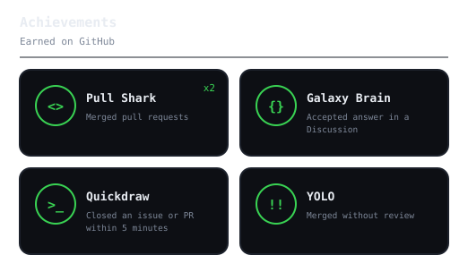

<!--
  github.com/geekksv/geekksv — the repo name matches the username, which is what
  makes GitHub render this file at the top of the profile page.

  The terminal, radar and gauge are SVGs committed to assets/, drawn by the scripts
  in scripts/ and refreshed by the workflows in .github/workflows/. Nothing here is
  fetched from a chart service at render time. See SETUP.md.

  The portrait and the signature now live inside the terminal, embedded as data URIs
  rather than referenced: an SVG that GitHub renders through  is isolated and
  cannot fetch an external image, so an href to either would come out blank.
  assets/portrait.svg is no longer used by this page; scripts/dotify.py still makes it.
-->

<div align="center">

<!-- TERMINAL — scripts/terminal.py. Replaces the typing-SVG banner that used to sit
     here: that fetched from a third-party service on every page view and said the same
     things this does. Two files paired with <picture>, matching the radar and language
     charts further down. -->
<picture>
  <source media="(prefers-color-scheme: dark)"  srcset="assets/terminal-dark.svg">
  <source media="(prefers-color-scheme: light)" srcset="assets/terminal-light.svg">
  
</picture>

<br>

<!-- Kept on one line on purpose. Split across three, GitHub turns each newline into a
     <br> and the badges stack into a column instead of sitting in a row.

     One flat colour across all three rather than each service's brand colour: the row
     then reads as a set of links, and the only thing carrying colour is the logo.

     logo=linkedin draws nothing: LinkedIn was pulled from Simple Icons, which is where
     shields.io gets its logos, so the slug silently resolves to no icon at all and the
     badge just comes out narrower. The mark is inlined as a data URI instead. Do not
     "tidy" this back to logo=linkedin -- the icon disappears and nothing warns you. -->
<a href="https://geekksv.pages.dev/"></a> <a href="https://linkedin.com/in/geekksv"></a> <a href="mailto:write.ksv@gmail.com"></a>

<br>

<!-- The one third-party service on this page, and unavoidably so: counting views
     needs a server that sees the requests, which a static README cannot do. -->


</div>

---

## `~/` whoami

```console
$ cat about.txt
```

DevOps and Linux engineer. I automate what was never meant to stay manual, and keep the
systems underneath it quiet.

- Running **10–25 production Linux servers** and the SIP layer on **OpenSIPS**
- **Docker, CI/CD, Zabbix and Grafana**; Python and Bash for the rest
- Shipping through **Git and GitHub Actions**, with monitoring that finds a fault before a customer does
- Building with **open models I run myself** — vision, speech, and local LLMs on hardware I control
- Learning **Kubernetes, Terraform and Ansible**

> The infrastructure work is not open source. These repos are the part I can show —
> the rest is at **[geekksv.pages.dev](https://geekksv.pages.dev/)**.

<br>

<div align="center">

## `~/` toolbox


</div>

---

<div align="center">

## `~/` where the time goes

<table>
<tr>
<td width="50%" align="center" valign="middle">

<!-- Both charts come from assets/skills.json; edit it and the workflow redraws them. -->
<picture>
  <source media="(prefers-color-scheme: dark)"  srcset="assets/radar-dark.svg">
  <source media="(prefers-color-scheme: light)" srcset="assets/radar-light.svg">
  
</picture>

</td>
<td width="50%" align="center" valign="middle">

<picture>
  <source media="(prefers-color-scheme: dark)"  srcset="assets/langs-dark.svg">
  <source media="(prefers-color-scheme: light)" srcset="assets/langs-light.svg">
  
</picture>

</td>
</tr>
</table>

</div>

---

<div align="center">

## `~/` contributions


<br><br>

<picture>
  <source media="(prefers-color-scheme: dark)"  srcset="https://raw.githubusercontent.com/geekksv/geekksv/output/snake-dark.svg">
  <source media="(prefers-color-scheme: light)" srcset="https://raw.githubusercontent.com/geekksv/geekksv/output/snake.svg">
  
</picture>

</div>

---

<div align="center">

## `~/` the numbers

<!-- Stars, repos and followers from REST; contributions and streaks from GraphQL,
     which is the only place GitHub exposes them. Drawn by scripts/cards.py. -->
<picture>
  <source media="(prefers-color-scheme: dark)"  srcset="assets/card-stats-dark.svg">
  <source media="(prefers-color-scheme: light)" srcset="assets/card-stats-light.svg">
  
</picture>

<br><br>

<!-- Hand-kept list: GitHub publishes profile achievements in no API, only in the
     HTML of the profile page. See assets/achievements.json. -->
<picture>
  <source media="(prefers-color-scheme: dark)"  srcset="assets/achievements-dark.svg">
  <source media="(prefers-color-scheme: light)" srcset="assets/achievements-light.svg">
  
</picture>

</div>

---

<div align="center">

## `~/` selected work

<!-- Cards drawn by scripts/cards.py from assets/projects.json; stars, forks and
     language come live from the API on every run. -->
<table>
<tr>
<td width="50%">
  <a href="https://github.com/geekksv/Qode">
    <picture>
      <source media="(prefers-color-scheme: dark)"  srcset="assets/card-Qode-dark.svg">
      <source media="(prefers-color-scheme: light)" srcset="assets/card-Qode-light.svg">
      
    </picture>
  </a>
</td>
<td width="50%">
  <a href="https://github.com/geekksv/artyom-robo">
    <picture>
      <source media="(prefers-color-scheme: dark)"  srcset="assets/card-artyom-robo-dark.svg">
      <source media="(prefers-color-scheme: light)" srcset="assets/card-artyom-robo-light.svg">
      
    </picture>
  </a>
</td>
</tr>
<tr>
<td width="50%">
  <a href="https://github.com/geekksv/mirror-dashboard">
    <picture>
      <source media="(prefers-color-scheme: dark)"  srcset="assets/card-mirror-dashboard-dark.svg">
      <source media="(prefers-color-scheme: light)" srcset="assets/card-mirror-dashboard-light.svg">
      
    </picture>
  </a>
</td>
<td width="50%">
  <a href="https://github.com/geekksv/MeetOn">
    <picture>
      <source media="(prefers-color-scheme: dark)"  srcset="assets/card-MeetOn-dark.svg">
      <source media="(prefers-color-scheme: light)" srcset="assets/card-MeetOn-light.svg">
      
    </picture>
  </a>
</td>
</tr>
</table>

<sub>

| project | live | stack |
|---|---|---|
| **[Qode](https://github.com/geekksv/Qode)** | [getqode.vercel.app](https://getqode.vercel.app) | `Go` `WebAssembly` |
| **[artyom-robo](https://github.com/geekksv/artyom-robo)** | [demo](https://geekksv.github.io/artyom-robo/) | `Python` `Raspberry Pi` `Flask` |
| **[mirror-dashboard](https://github.com/geekksv/mirror-dashboard)** | [walkthrough](https://github.com/geekksv/mirror-dashboard/blob/main/docs/screenshots/walkthrough.webp) | `JavaScript` `MagicMirror²` |
| **[MeetOn](https://github.com/geekksv/MeetOn)** | [meeton-i4dr.onrender.com](https://meeton-i4dr.onrender.com/) | `WebRTC` `Socket.IO` |

</sub>

<br>

<sub><a href="https://geekksv.pages.dev/">geekksv.pages.dev</a></sub>

<br><br>

<!-- "thanks for scrolling" — no plain-text twin on purpose; a translation under it
     would answer the only question it asks. -->
<sub><code>01110100 01101000 01100001 01101110 01101011 01110011 00100000 01100110 01101111 01110010 00100000 01110011 01100011 01110010 01101111 01101100 01101100 01101001 01101110 01100111</code></sub>

</div>
